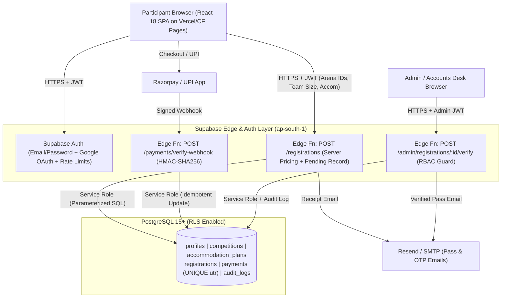
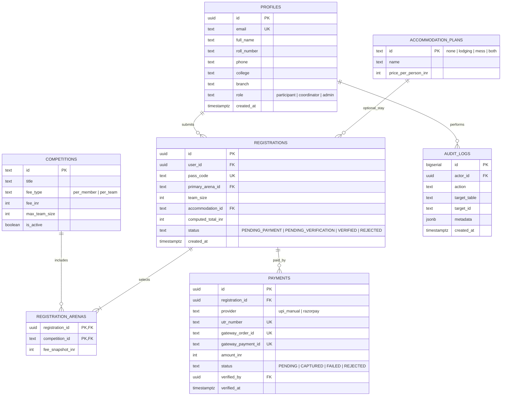

# ROXX BCE TECHNORITI — Backend Requirements Assessment

**Project:** ROXX TECHNORITI (`TECHNORITI '26`)  
**Institution:** Bhagalpur College of Engineering (BCE Bhagalpur)  
**Owner & Sole Contributor:** Sujal Sah (`RoxxSujal7`)  
**Repository:** `https://github.com/RoxxSujal7/roxx-bce-technoriti`  
**Assessment Date:** 2026-11-25  
**Skills Applied:** `/agency-software-architect`, `/agency-database-optimizer`, `/agency-security-architect`

> **Assessment Scope:** This document is a read-only architectural and security requirements assessment grounded in direct inspection of `src/` and `public/`. No frontend code, packages, or Git history were modified.

---

## 1. Executive Summary & Minimum Secure Backend

ROXX TECHNORITI is currently a **100% client-side React 18 SPA** (`react-scripts` 5.0.1, `HashRouter`, 11 public routes). Every competition (`src/content/events.jsx`), FAQ (`src/content/faq.jsx`), tariff (`src/components/ui/pricing-02.tsx`), and sponsor card (`src/screens/Sponsors.jsx`) is hardcoded in frontend bundles, while `/signin`, `/signup`, and `/register` are **visual prototypes** that neither authenticate users nor persist registrations or verify UPI payments.

### Minimum Secure Backend Required for Production
To transform this prototype into a functional, production-ready festival portal without altering the UI, the **minimum secure backend** consists of:
1. **Managed Auth + Identity Provider** (email/password + Google OAuth, verified JWT sessions, server-side rate limiting).
2. **Relational Database (PostgreSQL)** storing `profiles`, `competitions` (authoritative fees), `registrations`, `registration_arenas`, `accommodation_bookings`, `payments` (with a `UNIQUE` constraint on `utr_number`), and `audit_logs`.
3. **Server-Side Pricing & Registration API / Edge Functions** that compute `total_payable` exclusively from database tariff/event rows, reject manipulated client totals, and create `PENDING_VERIFICATION` records.
4. **Payment & UTR Verification Workflow** — either automated payment gateway webhooks (Razorpay/Cashfree HMAC-SHA256 verification) **or** a hardened UTR submission + RBAC-protected Admin Verification Desk that prevents duplicate UTR reuse and transitions registrations from `PENDING` → `VERIFIED` / `REJECTED`.
5. **RBAC-Protected Admin Endpoints** (server-verified `admin` role) for verifying UTRs, managing registrations, and exporting participant rosters.

---

## 2. Current Frontend-to-Backend Integration Map

Direct inspection of the codebase confirms the following current state across all 11 routes in `src/index.js`:

| Route | Component(s) | Current Implementation | Backend Gap / Requirement |
|---|---|---|---|
| `/signin`, `/signup` | `src/screens/Auth.jsx`, `src/components/ui/auth-fuse.tsx` | `SignInForm` & `SignUpForm` call `event.preventDefault()`; Google OAuth button is a no-op (`/* UI-only */`). No session, token, or password reset. | Real authentication, JWT/cookie session management, OAuth callback, rate limiting, password reset. |
| `/register` | `src/screens/Register.jsx` | Calculates `primaryCost`, `additionalCost`, and `accomCost` in browser JS (`lines 33-61`); builds `upi://pay` link and `api.qrserver.com` QR (`lines 117-123`); checks `/^\d{12}$/` on UTR (`line 109`) and sets `registrationSubmitted = true` in React state (`line 113`). Data is lost on refresh. | Server-side authoritative price calculation, persistent registration record, duplicate UTR prevention, real payment verification, server-generated pass code, confirmation email. |
| `/events` | `src/screens/Events.jsx`, `src/content/events.jsx` | 29 competitions hardcoded in `competitionsList` with client-side search/filter. | Optional CMS/DB sync in Phase 2; static catalog can stay in sync or be fetched from `competitions` table. |
| `/accommodation` | `src/screens/Accommodation.jsx`, `src/components/ui/pricing-02.tsx` | Static tariff cards (₹50 Lodging, ₹125 Mess, ₹175 Complete Stay, group discounts mentioned in `pricing-02.tsx:73-74`). | Authoritative accommodation tariff rows in DB (including group discount rules if enabled in checkout). |
| `/`, `/about`, `/sponsors`, `/team`, `/faq`, `/contact` | Respective screen & component files | Purely informational static content (`mailto:` and `tel:` links). | No backend required for MVP (optional contact/sponsorship inquiry form endpoint in Phase 2). |
| *(Missing)* | *(None in `src/index.js`)* | No `/dashboard` (participant pass view) or `/admin` (accounts desk UTR verification) exists in `src/`. | Participant pass lookup endpoint + RBAC-protected Admin Verification API (and UI route when implemented). |

---

## 3. Backend Requirements Analysis

| Requirement | Needed? | Why It Is Needed | Existing Frontend Touchpoint |
|---|---|---|---|
| **Backend API & Business Logic** | **Mandatory** | Client JS cannot enforce pricing, uniqueness, or state transitions. | `Register.jsx` checkout & `auth-fuse.tsx` forms |
| **Database & Data Models** | **Mandatory** | Registrations, UTRs, team members, and accommodation bookings currently vanish on page reload. | `Register.jsx` `formData` & `competitionsList` |
| **User Registration, Login & Sessions** | **Mandatory** | `/signin`, `/signup`, and "Continue with Google" currently perform zero authentication. | `src/components/ui/auth-fuse.tsx:189-260` |
| **RBAC & Admin Authorization** | **Mandatory** | Accounts desk / faculty coordinators need to verify UPI UTRs and view rosters without exposing PII to regular users. | `Register.jsx:493` ("verifies your payment slip against the accounts desk") |
| **Server-Side Validation & Sanitization** | **Mandatory** | Browser `required`, `maxLength`, and regex checks can be bypassed via DevTools or `curl`. | `Register.jsx:106-114`, `145-210` |
| **Payment Verification & Transaction Records** | **Mandatory** | Currently any 12-digit number marks a registration "Verified Slot" in React state. | `Register.jsx:521-525` |
| **UTR Verification & Duplicate Detection** | **Mandatory** | Without a DB `UNIQUE` constraint on `utr_number`, one paid UTR can be reused across unlimited registrations. | `Register.jsx:480-496` |
| **Server-Trusted Pricing & Cart Calculations** | **Mandatory** | `totalPayable` is computed in client memory and embedded directly in the `upi://pay?am=...` URL. | `Register.jsx:33-61`, `118` |
| **Rate Limiting & Abuse Prevention** | **Mandatory** | Prevents brute-force logins, registration spam, and OTP/email flooding. | `/signin`, `/signup`, `/register` |
| **Email Notifications & OTP Verification** | **Important (Phase 1/2)** | Email verification prevents fake accounts; registration receipts & verified pass emails reduce helpdesk load. | `auth-fuse.tsx` email inputs, `Register.jsx` receipt |
| **Secure File Uploads & Storage** | **Optional (Phase 2)** | `Accommodation.jsx:90-97` requires College ID & NOC physically at the gate; digital payment screenshot or NOC upload is optional. | `Accommodation.jsx:90-97` |
| **Audit Logs & Admin Activity Tracking** | **Mandatory (for Admin)** | Tracks who approved/rejected a UTR and when, preventing internal tampering or disputes. | Admin UTR verification workflow |
| **Backup, Recovery & Monitoring** | **Mandatory** | Protects registration and financial records during peak festival traffic (1,500+ delegates). | Production database & API |

---

## 4. Architecture Options Comparison & Recommendation

| Criterion | Node.js + Express + MongoDB | Node.js + Express + PostgreSQL | **Supabase (PostgreSQL + Auth + Edge Functions)** | Firebase (Firestore + Auth + Cloud Functions) |
|---|---|---|---|---|
| **Data Model Fit** | Document model; weak multi-table transactional integrity for UTR uniqueness + team/arena joins | Strong relational integrity, `UNIQUE` constraints, ACID transactions | **Strongest relational fit** (PostgreSQL ACID, foreign keys, `UNIQUE(utr_number)`, RLS) | NoSQL document model; awkward for relational reporting & strict cross-collection uniqueness |
| **Auth & Google OAuth** | Must build & maintain JWT/OAuth/reset flows yourself | Must build & maintain JWT/OAuth/reset flows yourself | **Built-in** (Email/Password, Google OAuth, JWT, rate limits) | Built-in |
| **Security & Access Control** | Express middleware only | Express middleware only | **Defense-in-depth:** PostgreSQL Row-Level Security (RLS) + Edge Function JWT/RBAC | Firestore security rules (easy to misconfigure for complex joins) |
| **Solo Developer Velocity** | Medium-Low (boilerplate heavy) | Medium | **Very High** (Auth, DB, Storage, Edge Functions, Admin Studio out of the box) | High |
| **Cost (Festival Scale)** | ₹400–₹1,500/mo VPS/App + Atlas | ₹400–₹1,500/mo VPS/Render + PG | **₹0/mo (Free tier) or ₹2,100/mo (Pro)** | ₹0/mo (Spark) or Pay-as-you-go (Blaze required for outbound calls) |

### Final Recommendation: **Supabase (PostgreSQL + Supabase Auth + Deno Edge Functions)**
- **Why:** For a solo developer (`Sujal Sah`) operating a collegiate festival with ~1,500 delegates, relational integrity (29 competitions, team sizes, accommodation combos, unique UTR enforcement), built-in Google OAuth matching `auth-fuse.tsx`, and minimal ops overhead make **Supabase** the optimal choice.
- **Alternative if self-hosting or using Razorpay heavily:** **Node.js (Fastify/Express) + PostgreSQL** on Render/Railway gives unrestricted Node.js SDK support (e.g., official `razorpay` npm SDK) with the exact same PostgreSQL schema below.

### Recommended Stack Specification
- **Backend Runtime:** Supabase Edge Functions (TypeScript/Deno) for all sensitive mutations (checkout, pricing calculation, UTR submission, payment webhooks, admin verification).
- **Database:** Managed PostgreSQL 15+ with Row-Level Security (RLS) enabled on every table.
- **Authentication:** Supabase Auth (Email + Password + Google OAuth PKCE), short-lived JWTs, email verification enabled.
- **Payment Strategy:**
  - *Option A (Recommended for Production):* **Razorpay / Cashfree Payment Gateway** — Edge Function creates an order with server-computed `amount_paise`, and a webhook endpoint verifies `X-Razorpay-Signature` (HMAC-SHA256) before marking `PAID`.
  - *Option B (Low-Budget / Manual UPI):* Retain the existing `upi://pay` QR flow, **but** submit the registration + 12-digit UTR to an Edge Function that stores `status = 'PENDING_VERIFICATION'` (never `'VERIFIED'`) and requires an authenticated `admin` to reconcile against bank statements.
- **File Storage (Phase 2):** Private Supabase Storage bucket (`delegate-docs`) with signed URLs, 2 MB max size, MIME/magic-byte check (`image/jpeg`, `image/png`, `application/pdf`).
- **Hosting:** Frontend on **Vercel** or **Cloudflare Pages** (replacing GitHub Pages so HTTP security headers—CSP, `X-Frame-Options: DENY`, HSTS—are served natively); Backend on **Supabase** (`ap-south-1` Mumbai region for low latency in Bihar/India).
- **Environment Variables:**
  - Frontend (public only): `REACT_APP_SUPABASE_URL`, `REACT_APP_SUPABASE_ANON_KEY`
  - Backend Edge Functions (secret, never in React): `SUPABASE_SERVICE_ROLE_KEY`, `RAZORPAY_KEY_ID`, `RAZORPAY_KEY_SECRET`, `RAZORPAY_WEBHOOK_SECRET`, `RESEND_API_KEY`

---

## 5. Proposed System Architecture Diagram

---

## 6. Database Schema & ER Diagram

Key PostgreSQL constraints (following `/agency-database-optimizer`):
- `PAYMENTS.utr_number` has a **partial unique index**: `CREATE UNIQUE INDEX uq_payments_utr_active ON payments(utr_number) WHERE utr_number IS NOT NULL AND status <> 'REJECTED';` — blocks duplicate UTR reuse atomically even under concurrent requests.
- Foreign keys (`user_id`, `registration_id`, `primary_arena_id`) are indexed for fast joins.
- `PROFILES.role` defaults to `'participant'` and is **blocked from user updates** via RLS (`WITH CHECK` / column-level trigger) so users cannot escalate to `'admin'`.

---

## 7. API Endpoint Specification

| Method & Path | Auth / Role | Purpose | Key Validation & Security Controls |
|---|---|---|---|
| `POST /auth/v1/signup`, `/token` | Public (Rate-limited) | Email/password & Google OAuth login | Built-in Supabase Auth rate limits, email confirmation, PKCE |
| `GET /functions/v1/me` | Authenticated JWT | Fetch user profile & own registrations | Scoped strictly to `auth.uid()` via RLS |
| `POST /functions/v1/registrations` | Authenticated JWT | Create registration & compute authoritative total | Ignores any client price; validates `team_size` (1–5 against `competitions.max_team_size`), deduplicates `additional_arenas`, computes `computed_total_inr` from DB |
| `POST /functions/v1/payments/submit-utr` | Authenticated JWT (Owner) | Submit 12-digit UTR for a `PENDING_PAYMENT` registration | Verifies `registration.user_id === auth.uid()`, enforces `/^\d{12}$/`, catches `23505` unique violation on `utr_number` |
| `POST /functions/v1/payments/webhook` | Gateway HMAC Signature | Automated Razorpay/Cashfree payment confirmation | Verifies `X-Razorpay-Signature` using `crypto.timingSafeEqual`, checks `amount === computed_total_inr * 100`, idempotent on `gateway_payment_id` |
| `GET /functions/v1/admin/registrations` | `admin` / `coordinator` | Paginated list of registrations & UTRs | Server checks `profiles.role IN ('admin', 'coordinator')`; never trusts client flags |
| `POST /functions/v1/admin/verify-utr` | `admin` only | Approve or reject a submitted UTR | Transactional update of `payments` + `registrations.status` + immutable `audit_logs` insert + sends pass email |

---

## 8. Security Requirements Checklist (Threat → Control Mapping)

| Threat | How Backend Prevents It |
|---|---|
| **Client-side price manipulation** | `POST /registrations` accepts only `primary_arena_id`, `additional_arena_ids[]`, `team_size`, and `accommodation_id`. Prices are fetched from `competitions` and `accommodation_plans` tables on the server. |
| **Fake or reused UTR submissions** | (1) `utr_number` has a PostgreSQL `UNIQUE` index preventing reuse across teams. (2) Submitting a UTR only sets `PENDING_VERIFICATION` — never `VERIFIED`. (3) Only `admin` reconciliation (or signed gateway webhook) marks a pass `VERIFIED`. |
| **Unauthorized admin access** | Admin routes/functions query `profiles.role` server-side using the verified JWT `sub` claim. React route hiding is UX only, never an access control. |
| **Privilege escalation on signup** | Signup endpoint/trigger hardcodes `role = 'participant'`. RLS `UPDATE` policy on `profiles` forbids modifying `role`. |
| **API abuse & brute-force** | Supabase Auth rate-limits login/OTP/signup; Edge Functions apply per-IP and per-user rate limits (e.g., Upstash Redis or DB token bucket) on `/registrations` and `/submit-utr`. |
| **Unauthorized data access (IDOR)** | Every table uses PostgreSQL RLS (`auth.uid() = user_id`), and Edge Functions verify ownership before returning receipts or pass codes. |
| **Credential & PII exposure** | `service_role` and payment secrets live only in server env vars; production source maps stay disabled (`GENERATE_SOURCEMAP=false`); no PII is sent to external QR APIs (generate QR locally via `qrcode` library or on-device `upi://` intent). |

---

## 9. Phased Implementation Roadmap & Migration Plan

### Phase 1 — Essential (Minimum Secure Production Backend)
1. Provision Supabase project (`ap-south-1`), run schema migrations (`profiles`, `competitions`, `accommodation_plans`, `registrations`, `registration_arenas`, `payments`, `audit_logs`), seed the 29 competitions and 3 accommodation tariffs.
2. Enable Supabase Auth (Email/Password + Google OAuth) and configure RLS policies.
3. Implement Edge Functions: `POST /registrations`, `POST /payments/submit-utr`, `POST /admin/verify-utr`, `GET /me`, `GET /admin/registrations`.
4. Integrate transactional email (Resend) for email verification and confirmed pass receipts.
5. Deploy frontend to Vercel / Cloudflare Pages with HTTP security headers (`CSP`, `X-Frame-Options: DENY`, `HSTS`).

### Phase 2 — Important (Reliability, Automation & UX)
1. Integrate **Razorpay** or **Cashfree** automated checkout + signed webhook verification (`POST /payments/webhook`) to eliminate manual UTR reconciliation.
2. Add a participant **My Pass / Dashboard** view (`/dashboard`) and an **Admin Verification Desk** (`/admin`).
3. Add optional private storage upload for College ID / NOC verification.
4. Wire `/contact` or sponsorship inquiry form to a rate-limited backend endpoint.

### Phase 3 — Future (Scale, Analytics & Automation)
1. QR-code gate check-in scanner for festival volunteers (verifying `pass_code` against `VERIFIED` DB status).
2. Automated contingent group-discount engine (`>4` and `12+` member rules from `pricing-02.tsx`) with atomic team-invite codes.
3. Live event schedule / leaderboard updates and automated CSV/PDF roster exports.

### UI-Preserving Migration Plan
1. **Zero visual redesign:** Keep `auth-fuse.tsx` (`AuthUI`) and `Register.jsx` layouts, styles, Tailwind/Bootstrap classes, and animations identical.
2. **Swap handlers cleanly:** Replace the no-op `handleSignIn` / `handleSignUp` / Google `onClick` in `auth-fuse.tsx` with `supabase.auth.signInWithPassword` / `signUp` / `signInWithOAuth`, displaying inline error/loading states.
3. **Hydrate `Register.jsx`:** Keep the live client-side fee preview for instant UX, but on submit call `POST /registrations` and display the **server-returned** `computed_total_inr`, `pass_code`, and `PENDING_VERIFICATION` / `PAID` status.

---

## 10. Estimated Development Timeline & Cost (INR)

**Estimated Timeline:**
- **Phase 1 (Essential):** 5–7 days (solo developer)
- **Phase 2 (Razorpay + Admin Desk + Dashboard):** +4–5 days
- **Phase 3 (Gate QR Scanner & Analytics):** +5–7 days

**Estimated Monthly & One-Time Costs (INR):**

| Cost Category | Low-Budget MVP (Free Tiers) | Production-Ready (Festival Month) | Free-Tier Limitations & Notes |
|---|---|---|---|
| **Development** | ₹0 (in-house by owner) | ₹0 (in-house) / ₹15,000–₹35,000 (if contracted) | — |
| **Domain (`.in` / `.org` / `.com`)** | ₹0 (use `*.vercel.app` / `*.pages.dev`) | ₹600 – ₹1,200 / year | Custom institutional/fest domain recommended for trust |
| **Frontend Hosting (Vercel / CF Pages)** | ₹0 / month | ₹0 / month | Free tiers support 100 GB+ bandwidth & custom HTTP security headers |
| **Backend & Database (Supabase)** | ₹0 / month (Free) | ~₹2,100 / month ($25 Pro, 1–2 months) | **Free tier limits:** 500 MB DB, 50k MAU, pauses after 7 days inactivity, 500k Edge Function invocations. Upgrade to Pro during fest month to prevent pausing & get daily backups. |
| **Email / OTP (Resend)** | ₹0 / month | ₹0 / month (or ~₹1,700/mo if >3k/mo) | **Free tier limit:** 100 emails/day, 3,000/month. Enough for ~1,500 delegates if spaced across registration weeks. |
| **Payment Gateway (Razorpay / Cashfree)** | ₹0 (Direct UPI + manual UTR desk) | **2% + GST** per domestic UPI/card txn (0% on some UPI plans depending on merchant agreement) | Manual UPI has ₹0 gateway fee but requires manual admin UTR reconciliation. |
| **File Storage** | ₹0 (included in Supabase) | ₹0 (included: 1 GB free, 100 GB Pro) | Only needed if Phase 2 ID/NOC upload is enabled |
| **Total Monthly Recurring** | **₹0 / month** | **~₹2,100 – ₹3,800 / month** (active fest months only) | Can downgrade/pause after festival ends |
